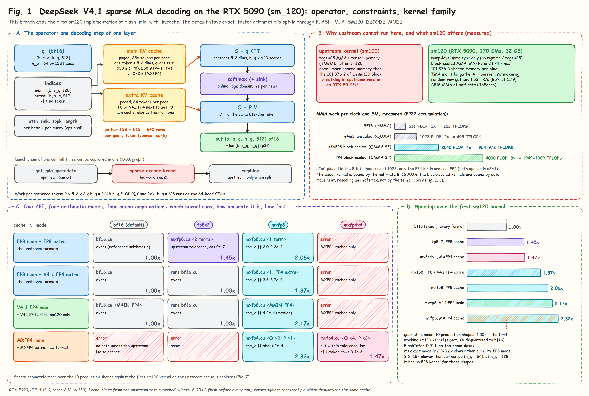
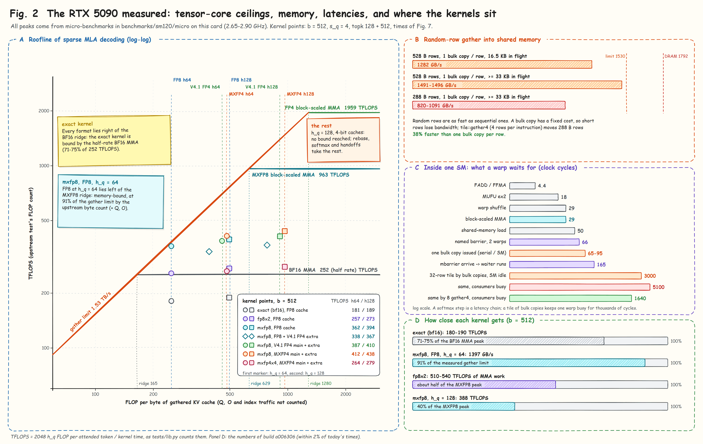
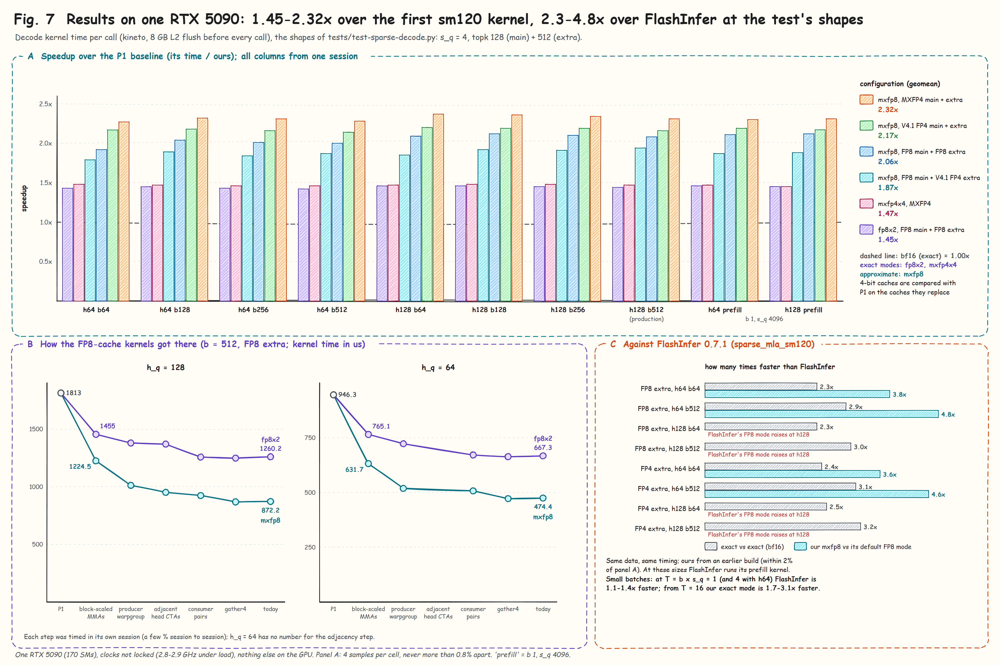
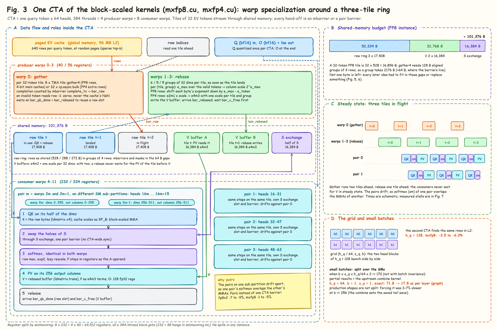
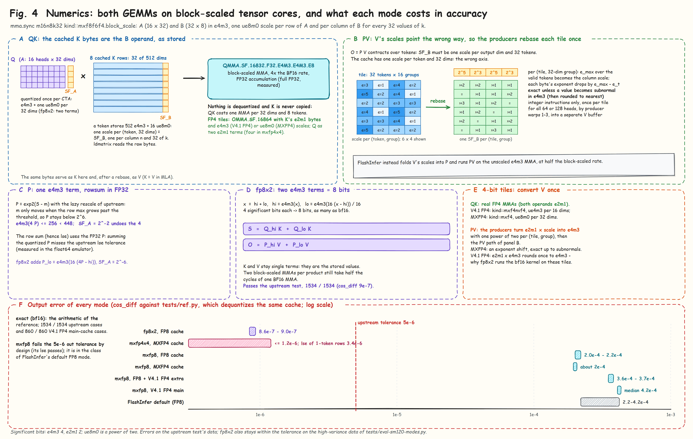
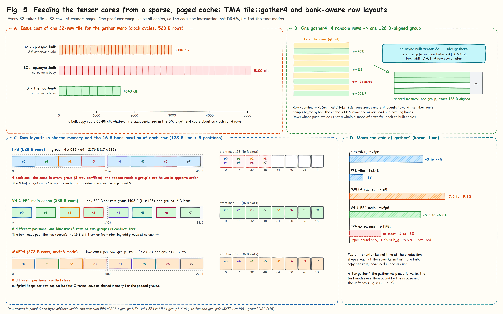
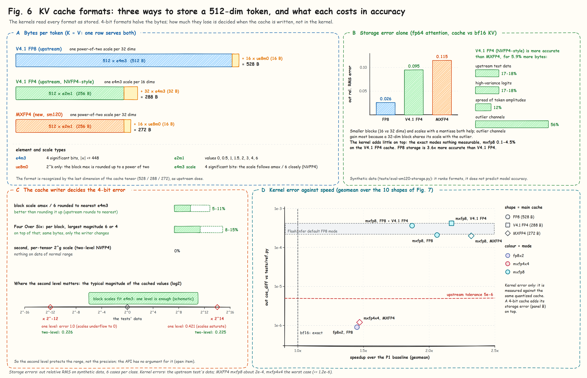

# FlashMLA for consumer Blackwell (RTX 5090, sm_120)

**DeepSeek-V4.1 sparse MLA decoding on the block-scaled FP8 / FP4 tensor cores of the RTX 50 series**

Upstream FlashMLA has no kernel that runs on sm120. Its DeepSeek-V4.1 sparse decoding kernels are written for the data-center
Blackwell parts (sm100): they use tcgen05 and tensor memory, which sm120 does not have, and more shared memory than the
101,376 B an sm120 block gets. This branch adds an sm120 implementation of `flash_mla_with_kvcache`, the V4.1 sparse (DSA)
decoding call. It keeps the upstream API and cache formats, passes the upstream test, and adds faster precision modes on the
block-scaled MMAs (`mma.sync` `kind::mxf8f6f4`, `kind::mxf4nvf4`, `kind::mxf4`). On this card those MMAs do 4x (FP8) and
8x (FP4) the work per clock of the BF16 MMA.
At the shapes of the upstream test, the fast modes are 1.45x to 2.32x faster than the first working sm120 kernel of this branch
(geometric means per configuration), and 2.3x to 4.8x faster than FlashInfer 0.7.1's `sparse_mla_sm120`. The default mode stays exact.

| | |
|---|---|
| Base | [deepseek-ai/FlashMLA](https://github.com/deepseek-ai/FlashMLA) `main` at [`2e5429f`](https://github.com/deepseek-ai/FlashMLA/tree/2e5429fc5653bab6e081f09477126f731882a6a9) (2026-09-30); the upstream README of that commit is [here](https://github.com/deepseek-ai/FlashMLA/blob/2e5429fc5653bab6e081f09477126f731882a6a9/README.md) |
| Hardware and toolchain | one GeForce RTX 5090 (170 SMs, 32 GB), driver 580.76.05, CUDA 13.0, PyTorch 2.12.1 (cu130); CUDA C++ only |
| Runs on sm120 | `flash_mla_with_kvcache` (V4.1 sparse decoding), h_q = 64 / 128, all upstream features. Not ported: sparse prefill, dense MHA, the fused norm-RoPE-attn-RoPE-cast kernel |
| Tests | upstream `tests/test-sparse-decode.py`: 1534 / 1534 in `bf16` and `fp8x2`; 856 MXFP4 cases; 860 V4.1 FP4 main-cache cases; a float64 emulator of every mode; CUDA Graph replay equals eager bit for bit |
| Technical reference | [docs/sm120/README.md](docs/sm120/README.md) (the tables of this page, the mode table, design notes) and [benchmarks/sm120/README.md](benchmarks/sm120/README.md) |
| Related work | the [`ampere-3090`](https://github.com/KernelFlow-ops/FlashMLA/tree/ampere-3090) branch of this fork: MLA decoding on RTX 3090 (sm_86), a separate code base |



## Contents

- [Highlights](#highlights)
- [1. Background](#1-background)
  - [1.1 The operator](#11-the-operator)
  - [1.2 Why the upstream kernels do not run on sm120](#12-why-the-upstream-kernels-do-not-run-on-sm120)
  - [1.3 What the RTX 5090 can do, measured](#13-what-the-rtx-5090-can-do-measured)
- [2. Results](#2-results)
  - [2.1 FP8 main cache](#21-fp8-main-cache)
  - [2.2 4-bit main caches](#22-4-bit-main-caches)
  - [2.3 Against FlashInfer](#23-against-flashinfer)
  - [2.4 Small batches and CUDA Graphs](#24-small-batches-and-cuda-graphs)
  - [2.5 How the kernels got there](#25-how-the-kernels-got-there)
- [3. Design](#3-design)
  - [3.1 One CTA: warp roles and a three-tile ring](#31-one-cta-warp-roles-and-a-three-tile-ring)
  - [3.2 Numerics: both GEMMs on block-scaled MMAs](#32-numerics-both-gemms-on-block-scaled-mmas)
  - [3.3 The memory path: TMA gather4 and bank-aware layouts](#33-the-memory-path-tma-gather4-and-bank-aware-layouts)
  - [3.4 KV cache formats](#34-kv-cache-formats)
  - [3.5 Small batches: split over the SMs](#35-small-batches-split-over-the-sms)
  - [3.6 Which kernel serves which request](#36-which-kernel-serves-which-request)
- [4. Accuracy](#4-accuracy)
- [5. Methodology](#5-methodology)
- [6. What did not work](#6-what-did-not-work)
- [7. Build, test and use](#7-build-test-and-use)
- [8. Benchmarks](#8-benchmarks)
- [9. Repository layout](#9-repository-layout)
- [10. Limitations and open items](#10-limitations-and-open-items)
- [Acknowledgement and citation](#acknowledgement-and-citation)

## Highlights

* **An exact kernel where there was none.** The default mode, `bf16`, dequantizes the cache to bf16 in registers and runs the
  BF16 MMA, as upstream does on sm100. It passes all 1534 cases of the upstream test with the upstream tolerances. This is the
  "P1 baseline" of every speedup on this page.
* **`fp8x2`: 1.45x and still within the upstream tolerance.** Q and P are each written as two e4m3 terms (8 significant bits, as
  many as bf16) and both GEMMs run on the block-scaled FP8 MMA. It passes 1534 / 1534 with an output error of about 9e-7.
* **`mxfp8`: 2.06x on the FP8 cache**, 1.87x with a V4.1 FP4 extra cache, 2.17x with the V4.1 FP4 cache as the main cache and
  2.32x with the new MXFP4 cache. Its error (cos_diff 2e-4 to 4e-4) is in the class of FlashInfer's default FP8 mode.
* **Both GEMMs on full-rate block-scaled MMAs.** K is used as stored, its scales are the MMA's scales. For PV, whose scales point the
  wrong way, the producer warps *rebase* each V tile once (integer instructions only), instead of folding the scales into P and
  running the half-rate unscaled FP8 MMA as FlashInfer does.
* **New cache options on sm120:** the V4.1 FP4 cache as the main cache, and an MXFP4 cache (272 B per token) with an `mxfp4x4` mode
  whose output stays within the upstream tolerance.
* **Against FlashInfer 0.7.1** (same data, same timing): exact mode 2.3x to 3.2x faster, fast mode 3.6x to 4.8x (h_q = 64); at
  h_q = 128 FlashInfer's FP8 mode raises at these shapes.
* **Small batches** are split over the SMs: one h_q = 64 decoding step of one token goes from 71.8 to 17.8 us per layer under a CUDA Graph.

## 1. Background

### 1.1 The operator

`flash_mla_with_kvcache` computes, for every query token and head, attention over a sparse set of cached tokens chosen by an
indexer (DeepSeek Sparse Attention):

* `q`: [b, s_q, h_q, 512] bf16 with h_q = 64 or 128; one shared KV head (h_kv = 1); d_qk = d_v = 512, so **K = V**: the same cached
  row is the key and the value.
* A paged, quantized **main cache** with `topk` indices per query token, and an optional **extra cache** with its own indices. The
  upstream test's production shapes use s_q = 4 (multi-token prediction), topk 128 into the main cache (page 256) plus 512 into
  the extra cache (page 64), and b = 64 to 512. Invalid indices are -1; the test fills unused cache rows with NaN.
* `attn_sink`, `topk_length` / `extra_topk_length`, split-KV (upstream splits when topk + extra_topk > 640), batch invariance.
* Output: `out` [b, s_q, h_q, 512] bf16 and `lse` [b, h_q, s_q] fp32.

A call is a chain of three kernels: scheduler metadata, the split-KV decoding kernel, and a combine kernel. The metadata and combine
kernels (`csrc/cuda_kernels/smxx/`) are upstream's and run on sm120 unchanged; this branch adds the decoding kernel.

Per query token and head, 640 cached rows are read and 2 x 640 x 512 x 2 FLOPs computed (QK and PV). At h_q = 64 that is 248 FLOP
per byte of an FP8 cache (528 B per token), 455 for the V4.1 FP4 cache (288 B) and 482 for MXFP4 (272 B); twice that at h_q = 128.

### 1.2 Why the upstream kernels do not run on sm120

| | sm100 / sm103 (B200, B300) | sm120 (RTX 5090, RTX PRO Blackwell) |
|---|---|---|
| tensor core instructions | `tcgen05.mma`, accumulators in tensor memory (TMEM), 2-CTA MMA | warp-level `mma.sync` only, accumulators in registers |
| shared memory per block | up to 227 KB | 101,376 B |
| BF16 MMA, FP32 accumulation | full rate | half rate (GeForce): 1/4 of block-scaled FP8 |
| block-scaled FP8 / FP4 MMA | yes | yes, m16n8k32 / m16n8k64 with scales per 32 (16) values of k |

The upstream head-64 kernel does not even launch on sm120 (its shared memory exceeds the limit). A port has to be a new kernel:
warp-level MMAs, a register-resident accumulator, and a pipeline that fits in a third of the shared memory.

### 1.3 What the RTX 5090 can do, measured



Before writing the kernel we measured the card with micro-benchmarks (`benchmarks/sm120/micro/`), because public numbers for
GeForce Blackwell were incomplete (for block-scaled FP8 there was one data point, from a smaller card):

| | FLOP per clock per SM | TFLOPS at 2.65 to 2.90 GHz |
|---|---|---|
| BF16 MMA, FP32 accumulation | 511 | 252 |
| e4m3 MMA without scales (`kind::f8f6f4`) | 1023 | 495 |
| block-scaled e4m3 (`kind::mxf8f6f4`, `scale_vec::1X`) | 2031 to 2047 | 954 to 972 |
| block-scaled FP4 (`kind::mxf4` 2X, `kind::mxf4nvf4` 4X) | 4085 to 4096 | 1949 to 1969 |

* The FP32 accumulation of the FP8 MMAs is full FP32, not the reduced-precision accumulator of some earlier FP8 parts.
* An e2m1 operand put into `kind::f8f6f4` runs at the FP8 rate, a quarter of the real FP4 rate; we use the real FP4 kinds only.
* Random row gather into shared memory reaches 1.53 TB/s (85% of the 1792 GB/s DRAM peak), and only with at least 33 KB in
  flight per SM.
* Latencies that shaped the design: an mbarrier hand-off between warps about 165 clocks, `SHFL` 29, `EX2` 18; one
  `cp.async.bulk` costs 65 to 95 clocks of issue whatever its size, and the copies of one SM are serialized.
* `setmaxnreg` works (232 registers for 8 consumer warps, 40 for 4 producer warps); cluster launch and distributed shared memory
  work; `wgmma` and `tcgen05` do not exist.

The roofline (Fig. 2 A) says what the kernel has to be. With the BF16 MMA, every cache format is compute bound (the ridge is at
165 FLOP/B, below the 248 of the FP8 cache at h_q = 64). With block-scaled FP8 MMAs (ridge 629) h_q = 64 is bound by the gather
and h_q = 128 is close to balanced; with FP4 MMAs (ridge 1280) everything is on the memory side. So both GEMMs have to run on
block-scaled MMAs, and then the gather and the work around the MMAs decide the speed.

## 2. Results

**How to read the tables.**
* Times are microseconds per decoding call: the time of the decode kernel as `tests/test-sparse-decode.py` measures it (kineto, 8 GB
  L2 flush before every call, 10 calls), taken with `benchmarks/sm120/bench_formats.py`.
* Shapes are the production shapes of the upstream test: s_q = 4, topk 128 (main cache, page 256) + 512 (extra cache, page 64),
  d_qk = d_v = 512, with the KV lengths of the test. The last two lines of each table are b = 1, s_q = 4096 ("prefill as decode").
* "P1 baseline" is the first working sm120 kernel of this branch (24ccda5): the upstream algorithm moved to `mma.sync`, with KV
  dequantized to bf16. Today's `bf16` mode is that algorithm. The factor in brackets is the P1 baseline's time divided by the cell's,
  i.e. the speedup. A 4-bit main cache is compared with the P1 baseline on the upstream caches it replaces: MXFP4 (main and extra)
  with FP8 main + FP8 extra, the V4.1 FP4 main cache (with a V4.1 FP4 extra cache) with FP8 main + V4.1 FP4 extra.
* All columns come from one session: build bd6f23e and the P1 baseline, each in its own process, alternating (2 passes in each of 2
  rounds). A cell is the median of its 4 samples, which were never more than 0.8% apart.
* Conditions: one RTX 5090 (170 SMs), driver clocks not locked (2.8 to 2.9 GHz under load), nothing else on the GPU.
* Modes: `bf16` and `fp8x2` pass the upstream tolerances, `mxfp4x4` passes them for the output (see [4. Accuracy](#4-accuracy)),
  `mxfp8` is approximate.



### 2.1 FP8 main cache

The upstream formats: FP8 main cache with an FP8 or a V4.1 FP4 extra cache. `fp8x2` with a V4.1 FP4 extra cache runs the `bf16`
kernel and is left out.

| h | b | FP8 extra: P1 baseline | bf16 | fp8x2 | mxfp8 | FP4 extra: P1 baseline | bf16 | mxfp8 |
|---|---|---|---|---|---|---|---|---|
| 64 | 64 | 162.8 | 163.2 (1.00x) | 113.7 (1.43x) | 84.6 (1.92x) | 162.5 | 162.6 (1.00x) | 90.7 (1.79x) |
| 64 | 128 | 302.7 | 302.7 (1.00x) | 209.0 (1.45x) | 148.4 (2.04x) | 302.0 | 302.3 (1.00x) | 160.2 (1.89x) |
| 64 | 256 | 517.6 | 520.0 (1.00x) | 361.2 (1.43x) | 256.9 (2.01x) | 518.1 | 519.6 (1.00x) | 281.0 (1.84x) |
| 64 | 512 | 950.8 | 953.1 (1.00x) | 667.3 (1.42x) | 474.4 (2.00x) | 950.6 | 950.7 (1.00x) | 509.0 (1.87x) |
| 128 | 64 | 299.9 | 299.7 (1.00x) | 206.1 (1.46x) | 143.2 (2.09x) | 298.4 | 300.1 (0.99x) | 161.4 (1.85x) |
| 128 | 128 | 520.4 | 516.9 (1.01x) | 355.2 (1.46x) | 245.3 (2.12x) | 520.4 | 517.8 (1.01x) | 271.5 (1.92x) |
| 128 | 256 | 952.2 | 948.4 (1.00x) | 654.7 (1.45x) | 453.5 (2.10x) | 951.2 | 948.0 (1.00x) | 499.2 (1.91x) |
| 128 | 512 | 1814.6 | 1811.6 (1.00x) | 1260.2 (1.44x) | 872.2 (2.08x) | 1813.6 | 1810.4 (1.00x) | 937.0 (1.94x) |
| 64 | 1 (s_q 4096) | 1793.0 | 1797.5 (1.00x) | 1224.9 (1.46x) | 848.1 (2.11x) | 1798.1 | 1796.5 (1.00x) | 960.0 (1.87x) |
| 128 | 1 (s_q 4096) | 3515.1 | 3510.8 (1.00x) | 2423.5 (1.45x) | 1658.3 (2.12x) | 3512.9 | 3509.8 (1.00x) | 1866.4 (1.88x) |
| geomean | |  | (1.00x) | (1.45x) | (2.06x) |  | (1.00x) | (1.87x) |

Where the kernels stand against the hardware (b = 512, upstream test counts of FLOPs and bytes, build a006306, whose times are within
2% of the table; Fig. 2 D):
* `bf16`: 180 to 190 TFLOPS, 71 to 75% of the BF16 MMA peak. It is bound by the BF16 MMA, which is half rate on GeForce parts.
* `mxfp8`, h = 64 with an FP8 extra cache: 1397 GB/s, 91% of the measured gather limit. It is memory bound; removing all of its
  softmax and rebase work saves only 2.4%.
* `mxfp8`, h = 128: 388 TFLOPS. The rebase of V and the softmax still cost 8 to 15% each (see [10](#10-limitations-and-open-items)).
* `fp8x2`: 254 to 268 TFLOPS, i.e. 510 to 540 TFLOPS of MMA work since every product runs twice, about half the block-scaled FP8 peak.

### 2.2 4-bit main caches

Both are sm120 only: MXFP4 main + extra, and V4.1 FP4 main + extra. `bf16` and `fp8x2` raise an error on an MXFP4 cache; `fp8x2` on
the V4.1 FP4 main cache runs the `bf16` kernel and is left out.

| h | b | MXFP4: mxfp8 | mxfp4x4 | V4.1 FP4 (NVFP4): bf16 | mxfp8 |
|---|---|---|---|---|---|
| 64 | 64 | 71.8 (2.27x) | 109.9 (1.48x) | 163.3 (0.99x) | 74.9 (2.17x) |
| 64 | 128 | 130.3 (2.32x) | 206.2 (1.47x) | 301.4 (1.00x) | 138.8 (2.18x) |
| 64 | 256 | 224.5 (2.31x) | 355.3 (1.46x) | 519.4 (1.00x) | 240.1 (2.16x) |
| 64 | 512 | 416.6 (2.28x) | 651.8 (1.46x) | 953.6 (1.00x) | 443.5 (2.14x) |
| 128 | 64 | 126.8 (2.37x) | 204.1 (1.47x) | 299.0 (1.00x) | 135.8 (2.20x) |
| 128 | 128 | 220.9 (2.36x) | 351.9 (1.48x) | 519.0 (1.00x) | 237.2 (2.19x) |
| 128 | 256 | 407.0 (2.34x) | 644.0 (1.48x) | 950.5 (1.00x) | 435.2 (2.19x) |
| 128 | 512 | 784.1 (2.31x) | 1231.4 (1.47x) | 1815.5 (1.00x) | 838.0 (2.16x) |
| 64 | 1 (s_q 4096) | 778.3 (2.30x) | 1222.2 (1.47x) | 1806.5 (1.00x) | 822.9 (2.19x) |
| 128 | 1 (s_q 4096) | 1524.6 (2.31x) | 2421.1 (1.45x) | 3527.9 (1.00x) | 1618.1 (2.17x) |
| geomean | | (2.32x) | (1.47x) | (1.00x) | (2.17x) |

* MXFP4 (272 B / token) in `mxfp8` mode is 8 to 15% faster than `mxfp8` on the FP8 cache (528 B / token), `mxfp4x4` 0 to 3% faster
  than `fp8x2`. Half the bytes do not make it twice as fast: these kernels are limited by the rebase, the softmax and the issue of the
  copies, not by DRAM. The cache takes half the memory.
* The V4.1 FP4 main cache (288 B / token) in `mxfp8` mode is 4.3 to 7.4% slower than MXFP4 (1.043x to 1.074x the time): it reads
  5.9% more bytes, and its rebase multiplies e2m1 values by e4m3 scales where MXFP4 only shifts exponents. It is 11 to 18% faster
  than `mxfp8` with an FP8 main cache and a V4.1 FP4 extra cache: every tile takes the FP4 path, Q is quantized once, and all rows
  come with gather4. Its `bf16` mode is exact and as fast as the P1 baseline.
* What the extra bytes of V4.1 FP4 buy in accuracy is in [3.4](#34-kv-cache-formats).

### 2.3 Against FlashInfer

FlashInfer 0.7.1, `sparse_mla_sm120` (the V4.1 sparse decoding that vLLM uses on sm120), on the same data with the same timing
method (`benchmarks/sm120/bench_flashinfer.py`). Our columns here are from build a006306, measured in the same session as FlashInfer
(within 2% of the tables above). At these shapes (T = b x s_q = 256 to 2048 query tokens) FlashInfer's wrapper uses its prefill
kernel; its decode kernels take at most 64 tokens per call. FlashInfer's exact mode (`bf16`) passes the upstream tolerance like
ours; its default mode computes with FP8 operands and has no kernel for h = 128 at these shapes (the call raises).

| extra | h | b | FlashInfer bf16 | ours bf16 | FlashInfer default | ours mxfp8 |
|---|---|---|---|---|---|---|
| FP8 | 64 | 64 | 375 | 163.6 (2.3x) | 326 | 85.4 (3.8x) |
| FP8 | 64 | 512 | 2792 | 953.2 (2.9x) | 2276 | 478.7 (4.8x) |
| FP8 | 128 | 64 | 705 | 301.7 (2.3x) | raises | 144.1 |
| FP8 | 128 | 512 | 5481 | 1810.8 (3.0x) | raises | 886.5 |
| FP4 | 64 | 64 | 397 | 163.0 (2.4x) | 333 | 91.5 (3.6x) |
| FP4 | 64 | 512 | 2991 | 950.3 (3.1x) | 2356 | 512.5 (4.6x) |
| FP4 | 128 | 64 | 766 | 304.0 (2.5x) | raises | 157.3 |
| FP4 | 128 | 512 | 5881 | 1809.8 (3.2x) | raises | 946.3 |

The main structural difference: FlashInfer runs PV on the unscaled e4m3 MMA (half the block-scaled rate) after folding V's
scales into P, and converts FP4 extra tiles to FP8 in shared memory. Here PV runs on the block-scaled MMA after a once-per-tile
rebase of V, and FP4 tiles run their QK on the FP4 MMA ([3.2](#32-numerics-both-gemms-on-block-scaled-mmas)).

### 2.4 Small batches and CUDA Graphs

A CTA serves one query token and 64 heads, so a small batch leaves most SMs idle. Upstream's rule (split only when topk +
extra_topk > 640) kept these shapes on one CTA per token: the baseline took 72 to 83 us whatever the size, 20 tiles in sequence.
On sm120 the requests are now split over the SMs ([3.5](#35-small-batches-split-over-the-sms)).

Kineto times in us (decode + combine kernel), 128 + 512 tokens, extra cache FP8. FlashInfer runs its decode kernel at these sizes.

| shape | T | baseline | bf16 | fp8x2 | mxfp8 | FlashInfer bf16 | FlashInfer default |
|---|---|---|---|---|---|---|---|
| h64, b1, s_q 1 | 1 | 72.7 | 19.1 | 16.7 | 16.0 | 16.9 | 14.8 |
| h64, b4, s_q 1 | 4 | 73.3 | 23.1 | 20.7 | 20.2 | 19.1 | 17.2 |
| h64, b1, s_q 4 | 4 | 73.2 | 24.2 | 22.4 | 21.0 | 17.1 | 15.4 |
| h64, b4, s_q 4 | 16 | 74.1 | 28.4 | 23.1 | 22.1 | 48.9 | 32.1 |
| h64, b16, s_q 4 | 64 | 76.6 | 55.9 | 39.3 | 33.0 | 137.3 | 87.9 |
| h128, b1, s_q 1 | 1 | 73.3 | 20.8 | 19.3 | 18.1 | 16.9 | 14.9 |
| h128, b1, s_q 4 | 4 | 73.5 | 24.7 | 21.3 | 19.7 | 27.4 | 19.3 |
| h128, b4, s_q 4 | 16 | 75.0 | 36.7 | 28.9 | 25.8 | 73.3 | 46.6 |
| h128, b16, s_q 4 | 64 | 82.6 | 83.7 | 54.7 | 39.9 | 263.1 | 245.1 |

From T = 16 on, our exact mode is 1.7x to 3.1x faster than FlashInfer's. At T = 1, and at T = 4 with h = 64, FlashInfer's exact
mode is still 1.1x to 1.4x faster than ours (its default mode is 1.1x to 1.4x faster than our `mxfp8`); about 6 us of our time
there is the combine kernel. Under a CUDA Graph (`benchmarks/sm120/bench_decode_graph.py`, every layer with its own KV cache), the
bf16 time per layer of h64 b1 s_q 1 goes from 71.8 to 17.8 us, and graph replay equals eager bit for bit for every shape and mode.

### 2.5 How the kernels got there

Fig. 7 B follows the FP8-cache kernels at b = 512 from the P1 baseline through the main steps. Each point is the upstream test's
kernel time (same method as the tables), but each step was measured in its own session, so neighbouring points can differ by a few
percent for reasons other than the change.

| step | what changed | h_q = 128: fp8x2 / mxfp8 (us) | h_q = 64: fp8x2 / mxfp8 (us) |
|---|---|---|---|
| P1 | upstream algorithm on `mma.sync`, KV dequantized to bf16 (today's `bf16`) | 1813 | 946.3 |
| block-scaled MMAs | QK with K as stored, V rebase, P as e4m3 | 1455 / 1224.5 | 765.1 / 631.7 |
| producer warpgroup | gather and rebase moved to 4 producer warps with `setmaxnreg` | 1379.8 / 1011.8 | 722.8 / 518.7 |
| adjacent head CTAs | the two CTAs of h_q = 128 launched next to each other (L2 reuse) | 1369.7 / 951.5 | (applies to h_q = 128 only) |
| consumer pairs | pair barriers instead of CTA barriers | 1257.3 / 923.5 | 671.4 / 507.3 |
| gather4 | TMA `tile::gather4`, 4 rows per instruction | 1248.1 / 868.2 | 663.6 / 471.6 |
| today | after the small-batch split and the 4-bit main caches (the FP8 path is unchanged) | 1260.2 / 872.2 | 667.3 / 474.4 |

The 4-bit caches followed the same path later: MXFP4 in `mxfp8` mode went from 861.0 to 784.1 us (h_q = 128, b = 512) with gather4,
and the V4.1 FP4 main cache from 880.6 to 838.0 us with gather4 and its bank-aware layout.

## 3. Design

The code is in `csrc/cuda_kernels/sm120/decode/sparse/`: `bf16.cu` (the exact path, all formats but MXFP4), `mxfp8.cu` (`fp8x2` /
`mxfp8` on the FP8 main cache with its FP4 extra tiles, and `mxfp8` on the V4.1 FP4 main cache), `mxfp4.cu` (the MXFP4 cache),
`run.cu` (mode dispatch), `common.h` / `kernel.h`, and the PTX wrappers in `csrc/cuda_kernels/sm120/ptx.h`. The rest of this
section describes the block-scaled kernels (`mxfp8.cu`, `mxfp4.cu`).

### 3.1 One CTA: warp roles and a three-tile ring



* **CTA = one query token x 64 heads, 384 threads.** h_q = 128 runs two CTAs. Tiles of 32 KV tokens stream through shared memory.
* **4 producer warps** with their registers lowered by `setmaxnreg` to 40 (56 where they convert FP4 tiles):
  * warp 0 gathers: row indices one tile ahead, the rows of a tile with 8 TMA `tile::gather4` instructions (or one
    `cp.async.bulk` per row where gather4 does not apply), completion counted by an mbarrier's transaction bytes;
  * warps 1 to 3 rebase V (6 / 5 / 5 of the 16 groups of 32 dims) as soon as a tile lands, into one of two V buffers.
* **8 consumer warps** with 232 registers (224 with FP4 tiles), in **four pairs**. Warps 2m and 2m+1 sit on different SM
  sub-partitions and share 16 heads: each computes S over half of the 512 dims, they swap halves through shared memory under a
  pair barrier, both run the same softmax, and each runs PV over half of the output columns (its O is 128 fp32 registers per
  thread). The two pairs on one sub-partition drift apart, so one pair's softmax overlaps the other's MMAs. Pairs instead of CTA
  barriers: `fp8x2` -7 to -9%, `mxfp8` -1 to -5%.
* **Shared memory is exactly 101,376 B**: a ring of 3 raw tiles (3 x 17,408 B: the rows as stored, in 128 B-aligned groups of 4
  rows), 2 V buffers (2 x 16,384 B), and the S exchange (16,384 B). mbarriers, masks and column scales live in the 64 B gaps
  between the row groups. 8 warps at 232 and 4 warps at 40 registers per thread use 64,512 registers, all that a 384-thread block can get.
* **Steady state**: gather two tiles ahead, rebase one tile ahead, the consumers on the current tile; with two V buffers a rebase
  never waits for the PV of the tile before it.
* **h_q = 128**: the grid is (h_q / 64, s_q, b), so the two CTAs of a token launch next to each other and the second finds the rows
  in L2 (`mxfp8` -3.5 to -6.0%).

### 3.2 Numerics: both GEMMs on block-scaled MMAs



`mma.sync.m16n8k32.kind::mxf8f6f4.block_scale` multiplies e4m3 A (16 x 32) by e4m3 B (32 x 8) with one ue8m0 scale per row of A
and per column of B for every 32 values of k.

* **QK with K as stored.** A cached FP8 token is 512 e4m3 values and one ue8m0 scale per 32 dims. With the token as a column of B,
  those scales are exactly SF_B, so `ldmatrix` reads the raw bytes into B fragments and nothing is dequantized or copied. Q is
  quantized once per CTA to e4m3 with one ue8m0 per 32 dims (`fp8x2`: two terms). FP4 tiles run QK on the FP4 MMA:
  `kind::mxf4nvf4` (ue4m3 scale per 16 dims) for the V4.1 FP4 cache, `kind::mxf4` (ue8m0 per 32) for MXFP4, with Q as two
  e2m1 terms (four in `mxfp4x4`).
* **PV and the V rebase.** O = P V contracts over tokens, so SF_B must be one scale per output dim and 32 tokens; the cache has one
  scale per token and 32 dims. The producers rebase each tile once: for every (tile, 32-dim group) the largest exponent over the
  valid tokens becomes the column scale, and every byte's exponent is shifted down by its token's difference to it. This is exact
  unless a value becomes subnormal in e4m3 (then it is rounded to nearest), uses integer instructions only, and costs the same for
  64 or 128 heads. FP4 tiles are converted once to rebased e4m3 (for MXFP4 an exponent shift; for V4.1 FP4, e2m1 x e4m3 rounds once).
* **P as e4m3.** The lazy rescale of upstream's softmax (the running max moves only when it grows past a threshold) keeps
  P <= 2^6, so e4m3(4 P) <= 256 < 448 with SF_A = 2^-2 undoing the factor. The row sum, and so the lse, uses the fp32 P: summing the
  quantized P misses the upstream lse tolerance (measured in the emulator).
* **fp8x2.** x = hi + lo with hi = e4m3(x), lo = e4m3(16 (x - hi)) / 16: 4 significant bits each, 8 together, as many as bf16.
  S = Q_hi K + Q_lo K and O = P_hi V + P_lo V; K and V stay single terms because they are the stored values. Two block-scaled MMAs
  per product still take half the cycles of one BF16 MMA.
* **Error ladder** (Fig. 4 F): `fp8x2` about 9e-7, `mxfp4x4` <= 1.2e-6, `mxfp8` 2e-4 to 4e-4 (cos_diff of the output against
  `tests/ref.py`, which dequantizes the same cache); the upstream tolerance is 5e-6.

### 3.3 The memory path: TMA gather4 and bank-aware layouts



Every tile is 32 rows at random pages, and one producer warp issues all copies. With one `cp.async.bulk` per row, issuing a tile
cost about 3000 clocks on an idle SM and 5100 with the consumers busy, which limited the fast modes before DRAM did.

* **`tile::gather4`** (`cp.async.bulk.tensor.2d ... tile::gather4`) copies 4 rows at 4 row coordinates into one 128 B-aligned group
  in shared memory: 8 instructions per tile, 1640 clocks with the consumers busy. The tensor map views the cache as
  [rows][row bytes / 4] of UINT32. Row coordinate -1 (an invalid token) delivers zeros and still counts toward the mbarrier's
  transaction bytes, so the cache's NaN rows are never read and nothing hangs. Caches whose page stride is not a whole number of
  rows fall back to bulk copies.
* **Layouts.** FP8 rows (528 B) are packed 4 to a group padded to 2176 B (17 x 128). A V4.1 FP4 row (288 B) is fetched in a 352 B box
  and a group is 1408 B (11 x 128); an MXFP4 row (272 B) in a 288 B box with 1152 B groups. Odd groups start 16 B later (column -4
  of the box), so the 8 rows one `ldmatrix` reads, 4 from each of two groups, fall on 8 different 16 B bank positions. FP8 groups
  are not shifted (their rows already start at 4 different positions); the rebase reads the two halves of a group in opposite order
  instead, and the V buffer uses an XOR swizzle.
* **Gains** (kernel time against the same kernel with one bulk copy per row): FP8 tiles in `mxfp8` -3 to -7%, MXFP4 in `mxfp8`
  -7.5 to -9.1%, the V4.1 FP4 main cache -5.3 to -6.8%. For FP4 extra rows next to an FP8 main cache gather4 gains at most 1 to 3%
  and is slower at h_q = 128, b = 512, so those rows keep one bulk copy each. `mxfp4x4` keeps per-row copies too: its four Q terms
  leave no shared memory for the padded groups.

### 3.4 KV cache formats



| format | layout | bytes / token | where |
|---|---|---|---|
| V4.1 FP8 (upstream) | 512 B e4m3 + 16 B ue8m0 (one scale per 32 dims) | 528 | main or extra |
| V4.1 FP4 (upstream, NVFP4-style) | 256 B e2m1 + 32 B e4m3 (one scale per 16 dims) | 288 | extra next to an FP8 main cache (as upstream); on sm120 also main, with a V4.1 FP4 extra cache or none |
| MXFP4 (new, `KVCacheLayout.V41_MXFP4Sparse`) | 256 B e2m1 + 16 B ue8m0 (one scale per 32 dims) | 272 | main, and extra next to an MXFP4 main cache |

The format is recognized by the last dimension of the cache tensor, as upstream does. `tests/quant.py` writes and reads all three.

How much the 4-bit formats lose (`tests/eval-sm120-storage.py`: fp64 attention on the dequantized cache against fp64 attention on
the unquantized bf16 KV, synthetic data):

* The output's relative RMS error is 2.6e-2 with the FP8 cache, 9.5e-2 with the V4.1 FP4 cache and 1.15e-1 with MXFP4.
* The V4.1 FP4 (NVFP4-style) cache is 17 to 18% more accurate than MXFP4 on upstream-style data, 12% with a spread of token
  amplitudes and 56% with outlier channels, for 5.9% more bytes: smaller blocks and scales with a mantissa both help.
* The kernel's modes add little: `mxfp8` adds 0.1 to 4.5% on the V4.1 FP4 cache, the exact modes nothing measurable.
* The cache writer matters as much as the format. Rounding the block scale amax / 6 to the nearest e4m3 (as upstream's writer
  does) is 5 to 11% more accurate than rounding it up, and choosing per block between 6 and 4 as the largest magnitude ("Four Over
  Six") gains another 8 to 15% with the same bytes.
* A second, per-tensor power-of-two scale (two-level NVFP4) changes nothing on such data. It matters only for values far outside the
  e4m3 scale range: at x 2^-12 the one-level format breaks down completely (relative error 1.0, two-level 0.226), at x 2^14 it
  saturates (0.421, two-level 0.225). It protects the range, not the precision.

These are numerical errors on synthetic data. They rank the formats; what a format does to a model has to be measured with the
model's own KV cache.

### 3.5 Small batches: split over the SMs

When b x s_q x (h_q / 64) <= num_SMs / 2 (85 on the RTX 5090) and batch invariance is not requested, the sm120 path splits each
request's 640 tokens over several CTAs and lets the upstream combine kernel merge the partial results. At the production shapes it
does not split: forcing it there was 3 to 7% slower at b >= 256, because the combine kernel costs more than the tail wave it saves.

### 3.6 Which kernel serves which request

The mode is read from `FLASH_MLA_SM120_DECODE_MODE` at every call (default `bf16`), so one process can switch between modes; the
API does not change.

| cache (main + extra) | `bf16` | `fp8x2` | `mxfp8` | `mxfp4x4` |
|---|---|---|---|---|
| FP8 + FP8 (or none) | `bf16.cu` | `mxfp8.cu`, 2 terms | `mxfp8.cu`, 1 term | error |
| FP8 + V4.1 FP4 | `bf16.cu` | `bf16.cu` | `mxfp8.cu`, FP4 extra tiles | error |
| V4.1 FP4 + V4.1 FP4 (or none) | `bf16.cu` | `bf16.cu` | `mxfp8.cu`, all tiles FP4 | error |
| MXFP4 + MXFP4 (or none) | error | error | `mxfp4.cu`, Q 2 terms | `mxfp4.cu`, Q 4 terms, P 2 terms |

Other combinations (an FP8 main cache with an MXFP4 extra cache, a V4.1 FP4 main cache with an FP8 or MXFP4 extra cache) raise an
error. On an MXFP4 cache no arithmetic that fits the registers and shared memory meets the upstream lse tolerance on rows with a
single valid token, so the caller has to choose `mxfp4x4` or `mxfp8` explicitly.

## 4. Accuracy

| mode | arithmetic | accuracy (vs `tests/ref.py`) | caches |
|---|---|---|---|
| `bf16` (default) | KV dequantized to bf16 in registers, BF16 MMA | exact: the upstream test passes 1534 / 1534; on the V4.1 FP4 main cache all 860 cases of `test-sparse-decode-sm120-nvfp4.py` pass the upstream tolerances | FP8 main + FP8 / FP4 extra; V4.1 FP4 main (+ V4.1 FP4 extra) |
| `fp8x2` | Q and P each as the sum of two e4m3 terms (8 significant bits), block-scaled e4m3 MMA | passes the upstream test 1534 / 1534 (out cos_diff about 9e-7) | FP8 main + FP8 extra; with V4.1 FP4 tiles (an FP4 extra or main cache) it runs the `bf16` kernel |
| `mxfp8` | Q and P as one e4m3 term; V4.1 FP4 tiles: QK on the NVFP4 MMA with Q as two e2m1 terms | out cos_diff 2.0e-4 to 2.2e-4 (FP8 extra), 3.6e-4 to 3.7e-4 (FP4 extra), median 4.2e-4 (V4.1 FP4 main cache); same class as FlashInfer's default FP8 mode (2.2e-4 to 2.6e-4 / 4.0e-4 to 4.2e-4). Fails the upstream out tolerance (5e-6) by design | all, including MXFP4 (Q as two MXFP4 terms) and the V4.1 FP4 main cache |
| `mxfp4x4` | MXFP4 cache only: Q as four MXFP4 terms on the FP4 MMA, P as two e4m3 terms | out within the upstream tolerance (cos_diff <= 1.2e-6); the lse of a query token with exactly one valid KV token is off by up to 3.4e-6 (upstream limit 1e-6) | MXFP4 main (+ MXFP4 extra) |

The upstream tolerance is cos_diff <= 5e-6 for the output and a relative 8 / 65536 for the lse. `mxfp8` passes 253 of the 1534
upstream cases, those whose tolerance an approximate mode can meet. Every change was checked with:

* the upstream `tests/test-sparse-decode.py` (1534 cases) in every mode;
* `tests/test-sparse-decode-sm120-mxfp4.py`: 856 cases of the MXFP4 cache, written after the upstream test with its corner cases
  (page sizes 1 to 576, rows with no valid token, `topk_length`, sinks, split and no split);
* `tests/test-sparse-decode-sm120-nvfp4.py`: 860 cases of the V4.1 FP4 main cache, with and without a V4.1 FP4 extra cache; `fp8x2`
  equals `bf16` bit for bit there, `mxfp8` is checked against its emulator row;
* `tests/eval-sm120-modes.py`: a float64 emulator of every mode (`tests/sm120_emu.py`). The kernels' bf16 outputs equal the
  emulator's in 99.9 to 100% of the elements, on upstream data and on high-variance logits, which upstream data does not exercise
  (its attention is close to uniform);
* `benchmarks/sm120/bench_decode_graph.py`: CUDA Graph replay equals eager bit for bit for all production and small shapes;
* no register spills in any build (`--ptxas-options=-v`, and `cuobjdump -sass` shows no local memory).

## 5. Methodology

**Timing.** Every number on this page is a kernel time measured like the upstream test measures it: kineto, an 8 GB write before
every call to flush the L2, 10 calls. Configurations that are compared in one table were measured in one session, in separate
processes that alternate, on a GPU nothing else used (a lock file serialized all GPU work on the machine). Clocks could not be
locked in the container; they ran at 2.8 to 2.9 GHz under load. A result measured without these conditions was not used.

**Profiling without Nsight Compute.** The container blocks the GPU performance counters (`ERR_NVGPUCTRPERM`), so no `ncu`. What
we used instead:

* micro-benchmarks for every hardware fact the design depends on (`benchmarks/sm120/micro/`: MMA rates and semantics of every
  `kind`, `ldmatrix` forms and bank behaviour, gather bandwidth versus bytes in flight, bulk copy and gather4 issue costs, ALU rates,
  `setmaxnreg` / cluster / gather4 availability);
* knock-out variants: the same kernel with one part removed (MMAs, rebase, softmax, gather), timed only, to bound what a part costs
  and what an optimization of it can gain;
* in-kernel tracing with `clock64` / `globaltimer` per warp and phase, to see who waits for whom;
* SASS audits (`cuobjdump -sass`): the MMA instructions really are `QMMA.SF` (block-scaled FP8) and `OMMA.SF` (FP4), never e2m1 in
  an FP8 container, no local memory;
* `nsys` with CUDA Graph node tracing for the three-kernel launch chain.

**Correctness first.** A fast mode was accepted only with an error bound fixed in advance (upstream tolerance for the exact modes,
"not worse than FlashInfer's FP8 mode on the same input" for `mxfp8`), on upstream data and on high-variance data.

## 6. What did not work

All measured on the same card and not kept:

| idea | result | why |
|---|---|---|
| Split-KV at the production shapes | 3 to 7% slower at b >= 256 | the combine kernel costs more than the tail wave it saves |
| Gather FP4 rows with `cp.async` from 128 producer threads | 4 to 6% slower | the extra issue slots compete with the consumers |
| Lookup-table or two-pass rebase of FP4 tiles | 1 to 4% slower | the rebase warp is bound by its latency chain, not by instruction count |
| Integer fast path of the FP8 rebase (97.5% hit rate) | up to 5% slower in `mxfp8`, no gain in `fp8x2` | the per-half vote serializes the two halves |
| Gather warp takes over part of the rebase after gather4 freed it | 3.5 to 5% slower | it waits on the previous tile, so the prefetch gets shallower |
| Consumer ping-pong (QK of tile t next to PV of tile t-1) | 3 to 5% slower | it holds the two V buffers longer than the rebase period allows |
| `mxfp8` with Q as one term and P as two (or the reverse) | no useful mode | no such mode is both cheaper than `fp8x2` and within the upstream tolerance |
| `fp8x2` natively on V4.1 FP4 tiles (Q as four NVFP4 terms after a per-head power-of-two prescale, P as two terms, V as hi + lo) | 5 to 11% slower than the `bf16` kernel it would replace | the third PV MMA and the room for the lo terms; single-token rows still missed the lse tolerance |
| PV on the FP4 MMA as well (SageAttention3-style: P as two-level NVFP4, V transposed and re-quantized to NVFP4 by the producers) | stopped after the micro-benchmark | the conversion costs the producers 2 to 3.5x the rebase, more than the faster MMA can save |
| gather4 for V4.1 FP4 extra rows next to an FP8 main cache | at most 1 to 3%, slower at h = 128, b = 512 | FP4 extra tiles are bound by the rebase and the softmax, not by the copies |

## 7. Build, test and use

```bash
git clone -b blackwell-5090 https://github.com/KernelFlow-ops/FlashMLA.git && cd FlashMLA
git submodule update --init --recursive

# sm_120a only (sm100 and sm120 targets cannot be mixed in one build); NVCC >= 12.8, tested with CUDA 13.0 + torch 2.12 (cu130)
FLASH_MLA_CUDA_ARCHS=sm_120a python setup.py build_ext --inplace
# or install it: FLASH_MLA_CUDA_ARCHS=sm_120a pip install -v . --no-build-isolation

cd tests
python test-sparse-decode.py                                    # the upstream test, exact mode (default)
FLASH_MLA_SM120_DECODE_MODE=fp8x2 python test-sparse-decode.py  # the same in a fast mode
python test-sparse-decode-sm120-mxfp4.py                        # MXFP4 cache, both of its modes
python test-sparse-decode-sm120-nvfp4.py                        # V4.1 FP4 cache as the main cache, all modes
python eval-sm120-modes.py --help                               # the float64 emulator of every mode
```

`tests/lib.py` was changed only to accept compute capability 12. The call is the upstream one; the cache format follows from the
cache tensor's last dimension and the arithmetic from the environment:

```python
import os
import torch
from flash_mla import get_mla_metadata, flash_mla_with_kvcache
from quant import KVCacheLayout, quantize_k_cache   # tests/quant.py

os.environ["FLASH_MLA_SM120_DECODE_MODE"] = "mxfp8"  # bf16 (default) | fp8x2 | mxfp8 | mxfp4x4; read at every call

# kv: [num_blocks, page_size, 1, 512] bf16 -> 528 B (FP8), 288 B (V4.1 FP4) or 272 B (MXFP4) per token
k_cache = quantize_k_cache(kv, KVCacheLayout.V41_MXFP4Sparse)
extra_k_cache = quantize_k_cache(extra_kv, KVCacheLayout.V41_MXFP4Sparse)

tile_scheduler_metadata, num_splits = get_mla_metadata()
out, lse = flash_mla_with_kvcache(
    q, k_cache, None, None, 512, tile_scheduler_metadata, num_splits,
    softmax_scale=scale, indices=indices,                     # indices: [b, s_q, topk] int32, -1 = invalid
    attn_sink=attn_sink, extra_k_cache=extra_k_cache, extra_indices_in_kvcache=extra_indices,
    topk_length=topk_length, extra_topk_length=extra_topk_length,
)
```

`FLASH_MLA_SM120_GATHER4=0` turns gather4 off (one bulk copy per row), for comparisons.

## 8. Benchmarks

Described in [benchmarks/sm120/README.md](benchmarks/sm120/README.md). All of them need the GPU to themselves while they time.

| script | what it measures |
|---|---|
| `benchmarks/sm120/bench_formats.py` | every cache format and mode against the P1 baseline, the upstream test's timing (the tables of [2.1](#21-fp8-main-cache) and [2.2](#22-4-bit-main-caches)) |
| `benchmarks/sm120/bench_decode_graph.py` | many layers in one CUDA Graph (each with its own KV cache), us per layer, eager vs graph bit check, production / small / 4-bit shape sets |
| `benchmarks/sm120/bench_flashinfer.py` | FlashInfer 0.7.1 `sparse_mla_sm120` on the same data: kernel times and errors |
| `benchmarks/sm120/micro/*.cu` | the hardware facts of [1.3](#13-what-the-rtx-5090-can-do-measured): MMA kinds, `ldmatrix`, gather bandwidth, gather4, ALU rates, FP4 V-transpose cost |

## 9. Repository layout

New:

```
csrc/cuda_kernels/sm120/ptx.h                     PTX wrappers: block-scaled mma.sync kinds, ldmatrix, TMA gather4, mbarrier, setmaxnreg
csrc/cuda_kernels/sm120/decode/sparse/bf16.cu     exact kernel (bf16 mode; fp8x2 on FP4 tiles)
csrc/cuda_kernels/sm120/decode/sparse/mxfp8.cu    block-scaled kernel: FP8 main cache (+ FP4 extra tiles), V4.1 FP4 main cache
csrc/cuda_kernels/sm120/decode/sparse/mxfp4.cu    block-scaled kernel: MXFP4 cache (mxfp8, mxfp4x4)
csrc/cuda_kernels/sm120/decode/sparse/run.cu      mode and format dispatch
csrc/cuda_kernels/sm120/decode/sparse/{common.h,kernel.h}
tests/test-sparse-decode-sm120-mxfp4.py           MXFP4 cache tests (856 cases)
tests/test-sparse-decode-sm120-nvfp4.py           V4.1 FP4 main-cache tests (860 cases)
tests/sm120_emu.py, tests/eval-sm120-modes.py     float64 emulator of every mode and its error report
tests/eval-sm120-storage.py                       storage error of the cache formats and writers
benchmarks/sm120/                                 benchmarks and micro-benchmarks (section 8)
docs/sm120/                                       technical reference and the figures of this page (docs/sm120/figures/src: their scripts)
```

Changed: `setup.py` (`FLASH_MLA_CUDA_ARCHS`; an sm120 build compiles only the sm120 kernels and the shared scheduler / combine
kernels), `csrc/api/*.cpp` and `csrc/api/common.h` (dispatch to sm120; the sm100-only entry points report "not supported" in an
sm120 build), `csrc/params.h`, `csrc/cuda_kernels/kv_cache_format.h` (MXFP4), `flash_mla/flash_mla_interface.py` (docstring),
`tests/quant.py` (MXFP4 and two-level NVFP4 writers, added only), `tests/lib.py`, `tests/kernelkit/platform.py` (compute capability 12).

## 10. Limitations and open items

* Only the sparse decoding kernel runs on sm120. Sparse prefill, dense MHA and the fused norm-RoPE-attn-RoPE-cast kernel do not.
* An FP8 main cache with an MXFP4 extra cache, and a V4.1 FP4 main cache with an FP8 or MXFP4 extra cache, are rejected with an error.
* `fp8x2` runs the bf16 kernel on V4.1 FP4 tiles (the native attempt is in [6](#6-what-did-not-work)).
* At h = 128 and with FP4 tiles, the remaining time is the V rebase and the softmax. On the V4.1 FP4 main cache the rebase still costs
  3 to 8%; a lookup table does not make it cheaper. The two CTAs of h = 128 convert the same tiles, and sharing that work is untried.
* A second-level scale for the V4.1 FP4 cache (one power of two per cache, which would fold exactly into the logit scale and the rebase
  exponent) is not exposed: it needs an API argument, and it only matters for caches whose values are far outside the e4m3 scale range.
* The re-quantization of Q at the switch from main to FP4 extra tiles costs 2 to 3% at b = 512 and 5 to 7% at b = 64 to 128.
* Smallest batches (T <= 4, h = 64): the combine kernel and the per-CTA setup leave us 1.1x to 1.4x behind FlashInfer.
* The defaults are unchanged: `bf16`; `bf16` / `fp8x2` raise on an MXFP4 cache.
* Accuracy was measured on synthetic data and the upstream test's data; the effect of the approximate modes and 4-bit caches on
  model quality was not measured.
* All measurements are from one RTX 5090. Other sm120 parts (RTX 5080 / 5070, RTX PRO Blackwell) have the same instructions and
  shared memory per block but other SM counts, clocks and memory bandwidth.

## Acknowledgement and citation

This branch builds on [deepseek-ai/FlashMLA](https://github.com/deepseek-ai/FlashMLA): the API, the cache formats, the test and its
reference, the scheduler and combine kernels are theirs. The external baseline and the source of several ideas is
[FlashInfer](https://github.com/flashinfer-ai/flashinfer)'s `sparse_mla_sm120`. The FP4 work drew on
[SageAttention3](https://arxiv.org/abs/2505.11594) (two-level FP4 attention), NVIDIA's [NVFP4 recipe](https://arxiv.org/abs/2509.25149),
[Four Over Six](https://arxiv.org/abs/2512.02010) (choosing 6 or 4 as the block maximum) and the
[OCP Microscaling (MX) specification](https://www.opencompute.org/documents/ocp-microscaling-formats-mx-v1-0-spec-final-pdf). The
`setmaxnreg` split and the 8-bit `ldmatrix` transpose draw on TensorRT-LLM's sm120 MLA kernel; FlashMLA itself is inspired by
[FlashAttention 2 & 3](https://github.com/dao-AILab/flash-attention/) and [CUTLASS](https://github.com/nvidia/cutlass).

```bibtex
@misc{flashmla2025,
      title={FlashMLA: Efficient Multi-head Latent Attention Kernels},
      author={Jiashi Li and Shengyu Liu and Yuanhang Sun},
      year={2025},
      publisher = {GitHub},
      howpublished = {\url{https://github.com/deepseek-ai/FlashMLA}},
}
```
